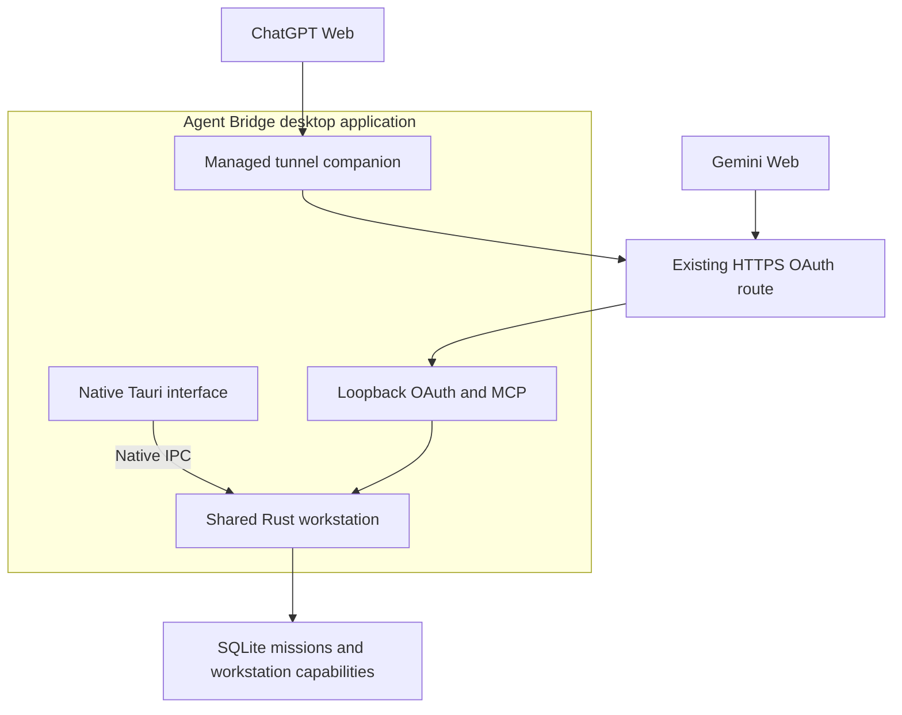
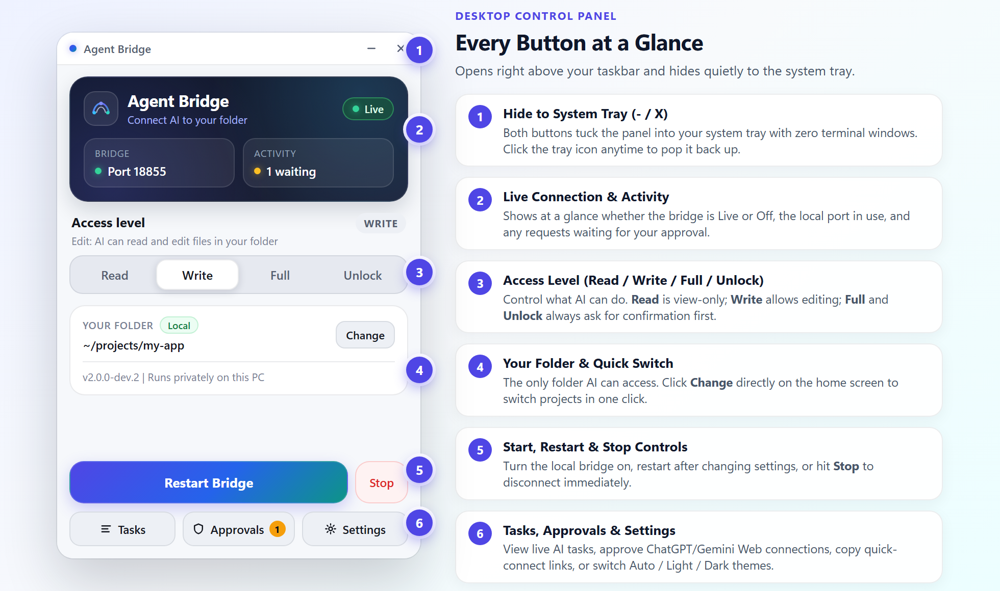
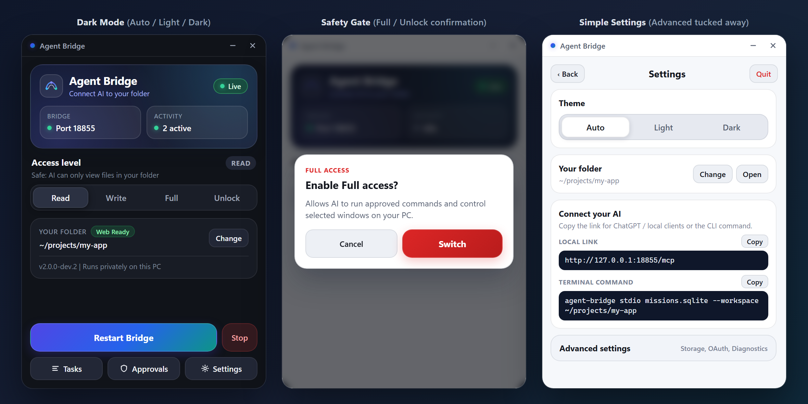

# Agent Bridge

> **Turn ChatGPT Web and Gemini Web into real local coding & workstation agents, with zero API token billing, zero extra runtimes, and fail-closed security.**

`Apache-2.0` · `Rust` · `MCP` · `Windows x64 stable (2.0.0)` · `Linux / macOS experimental` · `Tauri v2 Unified Desktop + Optional Web Console`

---

## Why Agent Bridge?

Most developers already pay for **ChatGPT Web** (Plus / Pro, with generous web allowances and **no per-token API bill**) or **Gemini Web** (using their **existing Gemini subscription quota**). Yet web AI chats stay trapped inside a browser tab:

- **Copy-paste purgatory:** Web chats cannot read your codebase, edit files, inspect git state, run pinned diagnostics, or verify a live page on your machine.
- **API coding agents burn tokens fast:** Paying per-token API bills across long refactoring sessions gets expensive quickly, while your existing ChatGPT Web or Gemini Web subscription sits underused.
- **Context vanishes across tabs and tools:** Closing a chat, hitting a context window limit, or switching between ChatGPT Web, Gemini Web, and a local CLI harness resets your progress.
- **Fragile, over-privileged wrappers:** Ad-hoc Node or Python MCP scripts often require heavy runtimes, expose unrestricted shells, follow symlinks outside your project, or store OAuth tokens in plaintext.

## What Agent Bridge Does

**Agent Bridge** is a shared **Rust workstation runtime**, available through a **native Tauri v2 desktop application** (`app/src-tauri`) and the **headless CLI** (`agent-bridge`) that bridges **ChatGPT Web**, **Gemini Web**, and any **local MCP client** directly to your machine under strict, operator-controlled boundaries:

- **Use the AI subscriptions you already pay for:** Connect ChatGPT Web (without per-token API charges) and Gemini Web (on your own Gemini subscription quota) to act as real local coding and workstation agents.
- **Zero external engine runtimes:** The compiled Rust CLI needs no Node.js, Electron, Python or Playwright runtime. The native application embeds the Rust workstation and uses the OS WebView; native desktop qualification covers Windows. ChatGPT Web connects through the optional official `tunnel-client` with a restricted tunnel runtime key; no model API key is required.
- **Unified native application:** One application owns the workstation and its optional tunnel companion. The interface uses native IPC to control the same live state as MCP, with no second operator HTTP port. Review Missions & Task Rooms, OAuth 2.1 requests, extensions and skills, and change modes within the startup ceiling. Existing attached-panel and standalone-gateway modes remain available.
- **43 native MCP tools (46 in the unified Windows catalogue):** 16 durable Mission & Subtask tools + 27 scoped Workstation tools covering files, chunked artifacts, versioned Agent Skills, persistent Task Rooms, native Chrome automation over private pipes, pinned processes, scoped Windows, macOS and Linux X11 UI controls, and Streamable HTTP extensions with OS-protected OAuth 2.1. The unified catalogue adds `agent_bridge_project_command` and the historical `agent_bridge_task_import` and `desktop_list_allowed_commands` utilities.
- **Seamless multi-agent handoffs:** Plan in ChatGPT Web, delegate a subtask to Gemini Web, and finish in a local `stdio` coding harness, all synchronized through one ACID SQLite v7 store with optimistic concurrency (`if_revision`) and idempotency keys.
- **Locally chosen authority:** Start with `read-only`, `workspace-write`, `full-control`, or explicitly opt into `fully-unlocked`. The embedded operator console can change the active mode within that startup ceiling. Direct shells require both startup `fully-unlocked` and `--enable-processes`; they run with the operator's existing OS permissions. Workspace file tools keep their confinement rules in every mode.

### At a Glance

| Capability | Plain Web Chat | API-Only Coding Agent | **Agent Bridge** |
| --- | :---: | :---: | :---: |
| Uses ChatGPT Web / Gemini Web subscriptions | Yes | No (per-token API cost) | **Yes** |
| Reads & edits local repositories safely | No | Yes | **Yes (workspace-confined)** |
| Durable multi-agent & cross-tab handoffs | No | Rare / vendor-locked | **Yes (SQLite v7 Missions & Task Rooms)** |
| Zero Node / Python / Playwright runtime | N/A | Usually required | **Yes (Rust CLI + Tauri v2 desktop app)** |
| Local-only permission & OS-protected OAuth boundary | N/A | Varies | **Yes (DPAPI / Keychain / Secret Service)** |

---

## Release Status & Supported Platforms

The **2.0.0** release is supported on **Windows 10/11 x64** as the portable native desktop application, running as a standard interactive Windows user. Other targets build and run in CI but are not equivalent distributions yet.

| Target / feature | Status | Notes |
| --- | --- | --- |
| Windows x64 desktop application (portable ZIP) | **Stable** | Tauri-owned workstation, MCP/OAuth listener, optional managed secure tunnel, unified 46-tool catalogue. Checksums are signed with the release key in `licenses/`; the executable is not Authenticode-signed. |
| Windows x64 headless CLI (built from source) | Stable for documented commands | Same Rust runtime, without the desktop shell. Build it with `cargo build --locked --release -p agent-bridge`; this release ships no prebuilt CLI binary or CLI ZIP. |
| Files, missions, Task Rooms, artifacts, skills, extensions, Fully Unlocked processes | Stable on Windows | Within the profile and confinement rules in [docs/WORKSTATION-MODES.md](docs/WORKSTATION-MODES.md). |
| Headless browser automation (pinned Chromium bundle) | Stable on Windows for the qualified actions | Isolated profiles; see [docs/TOOLS.md](docs/TOOLS.md). |
| Native window capture, Agent Desktop, visible input | Experimental | Unqualified operations refuse explicitly (for example `UI_EXACT_PASSIVE_UNQUALIFIED`, `REQUIRES_FOREGROUND_INPUT`). |
| Restricted Low-IL process execution | Unsupported | Refuses explicitly; never falls back to current-user execution. |
| Linux and macOS (CLI and desktop) | Experimental | See [docs/UNIX-PARITY.md](docs/UNIX-PARITY.md). No release binaries yet. |
| Installer (MSI/NSIS), auto-update, Authenticode signing | Not provided | Install by extracting the portable ZIP; update by side-by-side replacement (see [docs/QUICKSTART.md](docs/QUICKSTART.md)). |

A registered tool is not by itself a qualified feature: the matrix above, not the catalogue size, defines the supported scope.

## Roadmap

- Qualify exact-passive window capture (`0.5.0-agentbridge.3` WinApp derivative) and Agent Desktop with isolated fixtures before enabling them.
- Signed installer and update channel for Windows.
- Linux and macOS release matrices (CLI first, then desktop), each with its own notice review.
- Modernized MCP transport features, developed separately from the stable line.

Issues labelled `experimental` track the remaining work. Contributions are welcome; see [CONTRIBUTING.md](CONTRIBUTING.md).

---

## Architecture



The headless CLI remains available for local `stdio` clients and deliberately managed workstation services. Native mode embeds the same runtime without exposing operator commands on the MCP listener.

See **[docs/ARCHITECTURE.md](docs/ARCHITECTURE.md)** for the full 14-crate layout, SQLite v7 schema, and security boundaries.

---

## Native Desktop App (Tauri v2)

The native application has three explicit operating paths.

- **Unified native Workstation.** Configure a versioned `workstation-app.json` and launch the desktop executable. It owns the embedded backend and optional tunnel, uses native IPC for its controls, and needs only the permanent MCP/OAuth listener. Close or minimize hides the window; **Quit Agent Bridge** stops the managed stack. See [native configuration, lifecycle and migration](docs/UNIFIED-DESKTOP.md).
- **Attached Workstation.** The Workstation owner chooses the project, state paths and startup profile. Launch the service with `--ui-port` and configure the panel with a private `operator-connection.json` and Workstation stdout log. The panel shows the authenticated session and its `Read` / `Write` / `Full` / `Unlock` modes within the startup ceiling. Project changes and state initialization belong to the owner.
- **Standalone local gateway.** Launch the panel without a Workstation connection file to choose the project and private state paths, initialize SQLite and settings, and manage the panel's own local gateway. The mode selector saves a preference in this path.

In attached mode, **Stop** requires an authenticated session that supports cooperative shutdown. The panel waits for the service ports to close. **Start** and **Restart** require a validated Windows scheduled-task owner. If the owner is unavailable, a connected session still offers **Stop** when it supports shutdown. The panel shows the transition as soon as the action is requested and refreshes the result before accepting further changes. See [Workstation modes and lifecycle](docs/WORKSTATION-MODES.md#control-an-attached-workstation).

These illustrations show the earlier standalone panel. Its button legend, version and settings reflect that earlier build. Use the lifecycle and permission rules above for the current attached panel.





Build or test the independent desktop workspace from the repository or source ZIP. Windows validation uses the WebView2 Runtime. macOS uses WKWebView and Linux uses WebKitGTK. Current native panel build and test evidence covers Windows.

```sh
cargo test --locked --manifest-path app/src-tauri/Cargo.toml
cargo build --locked --manifest-path app/src-tauri/Cargo.toml
```

Find the default debug executable at `app/src-tauri/target/debug/agent-bridge-desktop-app` (with `.exe` on Windows). With `--target-dir` or `CARGO_TARGET_DIR`, look under that directory's `debug/`.

---

## Quick Start (3 Minutes)

### 1. Build from Source

The local Windows x86-64 MSVC builds and tests used Rust and Cargo 1.99.1. The minimum supported Rust version is undetermined. Build using the checked-in Cargo lockfile.

```sh
cargo build --locked --release -p agent-bridge
```

The standalone executable is written to `target/release/agent-bridge` (`target\release\agent-bridge.exe` on Windows).

### 2. Initialize Private State (Outside Your Repository)

Keep the SQLite database and private operator settings in a directory **separate** from your code repository:

```sh
agent-bridge db init /path/to/private/database/missions.sqlite
agent-bridge settings init /path/to/private/settings
```

### 3. Connect a Local Coding Harness (`stdio`)

Point any MCP-compatible CLI or IDE harness at `agent-bridge stdio`:

```sh
# Read-only repository inspection
agent-bridge stdio /path/to/private/database/missions.sqlite \
  --workspace /path/to/your-project

# Full coding agent mode (file edits, artifacts, Task Rooms, versioned skills, extensions)
agent-bridge stdio /path/to/private/database/missions.sqlite \
  --write-workspace /path/to/your-project \
  --settings /path/to/private/settings
```

### 4. Connect ChatGPT Web or Gemini Web

**ChatGPT Web: use the official Secure MCP Tunnel connection.** Install the supported `tunnel-client`, associate the tunnel with your ChatGPT workspace, and give its runtime key only **Tunnels: Read + Use**. In [ChatGPT Plugins](https://chatgpt.com/plugins), select **+ → Add custom MCP server → Connection: Tunnel**, choose that tunnel and complete Agent Bridge's local OAuth approval.

| Client | Transport |
| --- | --- |
| **ChatGPT Web** | Official Secure MCP Tunnel to the authenticated Agent Bridge Workstation relay. |
| **Gemini Web** | HTTPS OAuth relay through Tailscale Funnel, Cloudflare Tunnel or an HTTPS reverse proxy you operate. |
| **Local MCP clients** | Direct `stdio` or loopback HTTP; no tunnel account or runtime key. |

The relay keeps its own OAuth 2.1 + PKCE S256 and local approval. Secure MCP Tunnel handles the ChatGPT MCP connection; its OAuth discovery does not automatically publish the browser-facing authorization endpoint. Preserve the HTTPS OAuth route needed by your deployment and by Gemini.

Follow **[the complete Web connection guide](docs/QUICKSTART.md#5-connecting-chatgpt-web-and-gemini-web)** for exact relay and PowerShell commands, isolated Tunnel profiles/state, secret handling, enrollment, the ChatGPT creation flow, background supervision and native tool verification. A connected plugin is validated only after a real `desktop_policy_status` and `desktop_read_file` call succeeds.

Changes between `Read`, `Write`, `Full` and `Unlock` within the startup ceiling preserve OAuth grants. New startup authority or a different protected scope can require fresh authorization; changing the active mode alone does not.

### 5. Optional Local Web Operator Console (`agent-bridge ui`)

Use the [unified native desktop application](docs/UNIFIED-DESKTOP.md) for an application-owned workstation. An [attached panel](docs/WORKSTATION-MODES.md#attach-the-native-desktop-application) remains available for an externally owned service. The following console is an optional browser-based operator surface.

Launch the embedded, zero-dependency local web dashboard (binds IPv4 loopback `127.0.0.1` only, protected by a per-session 256-bit token and strict `Host`/`Origin`/`CSP` guards) to inspect **Missions & Task Rooms**, approve **OAuth 2.1** requests and **MCP Extension** proposals, manage **Documentary Skills**, and check platform diagnostics:

```sh
agent-bridge ui \
  --database /path/to/private/database/missions.sqlite \
  --settings-dir /path/to/private/settings \
  --oauth-state /path/to/private/oauth-workstation \
  --oauth-origin <https-workstation-origin> \
  --oauth-audience workstation \
  --project /path/to/your-project \
  --open
```

To enable the authenticated operator listener on a Workstation, add `--ui-port 18890` to `agent-bridge gemini workstation`. Add `--ui-open` only to launch the browser console automatically. Its four mode buttons apply immediately within the startup ceiling; changing modes preserves the process, MCP listener, OAuth state and existing grants. A standalone `agent-bridge ui` has no live workstation to control. See [live workstation modes and direct process contracts](docs/WORKSTATION-MODES.md).

Step-by-step setup guides for the native desktop app, local `stdio`, ChatGPT Web, Gemini Web, read-only `gemini project-read`, Chrome sessions, and dedicated window inspection: **[docs/QUICKSTART.md](docs/QUICKSTART.md)**.

---

## Tool Surface (up to 43 MCP Tools, 46 unified)

| Family | Surface | Highlights |
| --- | :---: | --- |
| **Missions & Subtasks** | **16 tools** | Durable multi-agent contexts, optimistic concurrency (`if_revision`), idempotent create/complete, ownership transfer, checkpoints, and shared subtasks. |
| **Workspace Files & Policy** | **9 tools** | Workspace-confined `read`, `write`, `edit`, `move`, `list`, `search`, `get_file_info`, `create_directory`, and `policy_status`. Enforces single-use `observation_id` on mutations and rejects symlinks, reparse points, and traversal. |
| **Chunked Artifacts** | **5 actions** | Publish SHA-256 verified temporary artifacts (`desktop_artifact_manage`), inspect metadata, stream UTF-8 (multi-byte safe boundary trimming) or Base64 chunks, and delete explicitly. |
| **Versioned Agent Skills** | **7 actions** | Documentary-only skill packages (`desktop_skill_manage`): `list`, `get`, `read`, `validate`, `install`, `activate`, `rollback`. Supports local directories, strict local ZIPs, and allowlisted HTTPS ZIPs verified by SHA-256. Scripts are never auto-executed. |
| **Persistent Task Rooms** | **11 actions** | Project-bound durable work rooms (`desktop_task_manage`) with isolated capability handles, handle rotation on `context_reattach`, step checkpoints, `block`/`resume`, `final_review`, and completion gates. |
| **Native Chrome Browser** | **3 tools** | Rust-only Chrome automation over private inherited stdio CDP pipes (zero Node/Playwright, zero TCP debug socket). All **9/9 session actions** (`start`, `list`, `close`, tabs, `handle_dialog`, persistent `list_profiles`/`delete_profile`), `snapshot` (`full`/`find`/PNG), and **17 DOM action types**. Unix project file upload/download remains explicitly unavailable; see [platform coverage](docs/UNIX-PARITY.md). |
| **MCP Extensions & OAuth 2.1** | **4 tools** | Streamable HTTP upstream MCP registry (`desktop_mcp_manage`, `tool_search`, `tool_inspect`, `tool_call`). All **11/11 management actions**, including outbound OAuth 2.1 PKCE `S256` (`set_oauth`, `auth_start`, `auth_status`, `auth_disconnect`) backed by **Windows DPAPI**, **macOS Keychain** or **Linux Secret Service** token protection. |
| **Owned Processes** | **4 tools** | SHA-256 pinned commands retain their restricted provider. An explicitly opted-in fully-unlocked workstation exposes direct shell or literal program/argument sessions; live downgrades revoke those sessions. See [process modes](docs/WORKSTATION-MODES.md). |
| **Scoped Desktop UI** | **up to 4 tools** | `desktop_agent_desktop`, `desktop_ui_windows`, `desktop_ui_snapshot`, `desktop_ui_action` (`wait`, `invoke`, `set_value`, semantic `scroll`, bounded post-message `send_keys` on non-password `Edit` controls). Windows physical pointer/keyboard injection is refused (`REQUIRES_FOREGROUND_INPUT`). macOS AX and Linux X11 expose three scoped tools with their own supported actions and consent requirements; see [platform coverage](docs/UNIX-PARITY.md). |

The catalog depends on the startup mode, explicit capability flags and platform. Full tool reference, action matrices, and schemas: **[docs/TOOLS.md](docs/TOOLS.md)**. Candidate release notes and qualification gates: **[docs/RELEASE-v2.0.0.md](docs/RELEASE-v2.0.0.md)**.

---

## Security Model & Profiles

Agent Bridge treats every prompt and remote client as untrusted. Permissions are chosen **strictly on the local machine** and cannot be escalated over MCP:

| Profile / Mode | Files & Artifacts | Task Rooms & Skills | Extensions | Processes | Browser / Window |
| --- | --- | --- | --- | --- | --- |
| `gemini project-read` | 4 read-only tools (`depth=1`, no secrets/hidden files) | Off | Off | Off | Off |
| `read-only` (`--workspace`) | Read-only (5 file tools + artifact read/list) | Read-only skills (`--settings`) | Inspect & queue proposals | Off | Local CLI opt-in only |
| `workspace-write` (`--write-workspace`) | Full workspace read/write (observation-checked) | Full Task Rooms & local skills | Inspect & queue proposals | Off | Local CLI opt-in only |
| `full-control` (`AGENT_BRIDGE_DESKTOP_PROFILE=full-control`) | Full workspace read/write | Full + allowlisted HTTPS ZIP skills | Full + local operator approval | Pinned SHA-256 commands only | Local CLI opt-in only |
| `fully-unlocked` workstation | Full workspace read/write through file tools | Same capability opt-ins | Same local operator approval | Direct shell/program sessions only with `--enable-processes` | Same local CLI opt-in |

This table describes startup authority. The workstation's embedded console can reduce or restore its active mode within that ceiling. File-tool confinement remains in place; direct processes in fully-unlocked can access any resource permitted by the current OS account.

Key invariants:
- **Zero plaintext OAuth tokens:** Outbound extension tokens are protected per server by OS-native storage (**Windows DPAPI**, **macOS Keychain**, or **Linux Secret Service**), never written in plaintext to `extensions.json` or logs.
- **Personal browser profiles stay untouched:** Native Chrome launches with isolated Bridge-owned profiles (ephemeral by default, or scoped under `<settings>/mcp-browser-profiles` when explicitly requested via `profile_id`).
- **Explicit human approval gates:** OAuth enrollment/approval, extension administration (`approve`/`refuse`), and dedicated window selection require an interactive local terminal or native OS dialog (defaulting to **No**).

---

## Testing & Verification

Run the complete native Rust test suite across all **14 workspace crates**:

```sh
cargo test --locked --offline --workspace
```

The workspace suite covers file policy, process confinement, operator console authentication, OAuth and durable mission lifecycles.

Run the native desktop application backend tests:

```sh
cargo test --locked --manifest-path app/src-tauri/Cargo.toml
```

Verify signed release checksum manifests against the repository public key:

```sh
openssl dgst -sha256 -verify licenses/agent-bridge-release-public.pem -signature SHA256SUMS.sig SHA256SUMS
```

---

## Documentation

Open this README in the companion source ZIP or repository to follow its relative documentation links and view the illustrations. The portable desktop ZIP supplies this README, the desktop executable and its attribution files; it does not include the headless CLI, which you build from source.

- **[Quick Start Guide](docs/QUICKSTART.md)**: Build, native desktop app, local `stdio`, ChatGPT Web, Gemini Web OAuth 2.1, Chrome sessions, and Window modes
- **[MCP Tool Reference](docs/TOOLS.md)**: Complete 43-tool reference (plus the three unified-catalogue additions), action matrices, and safety limits
- **[Architecture Guide](docs/ARCHITECTURE.md)**: 14-crate workspace architecture, SQLite v7 schema, OS-protected OAuth, and deterministic packaging
- **[Security Policy](SECURITY.md)**: Security invariants and private vulnerability reporting
- **[Contributing Guide](CONTRIBUTING.md)**: Local build/test workflow and contributor guidelines

---

## License & Notices

Licensed under the **[Apache License, Version 2.0](LICENSE)**.

The root `LICENSE` covers all Agent Bridge source code (Rust crates, desktop app, scripts, contracts, and SQLite migrations). Third-party crates, SQLite, and the Rust standard library retain their own licenses and notices; see **[NOTICE](NOTICE)** and the `notices/` directory in binary distributions.
